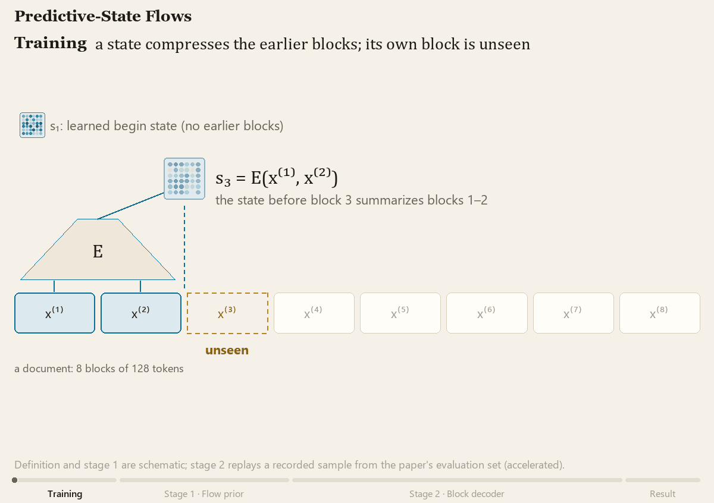
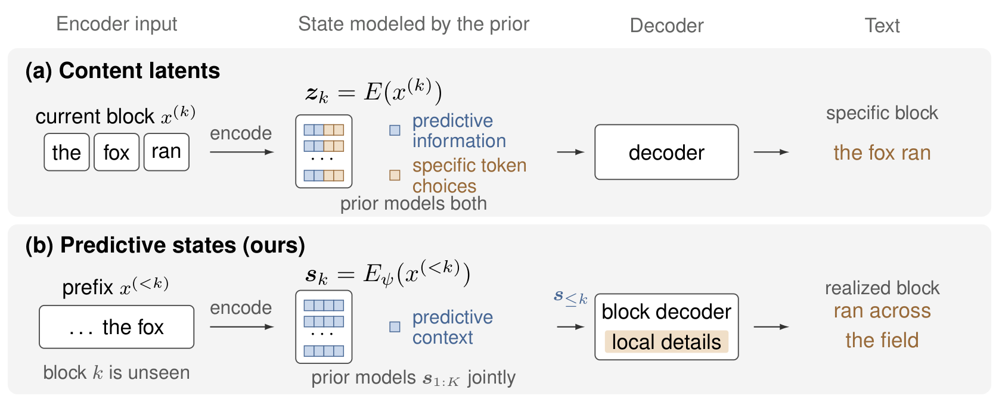
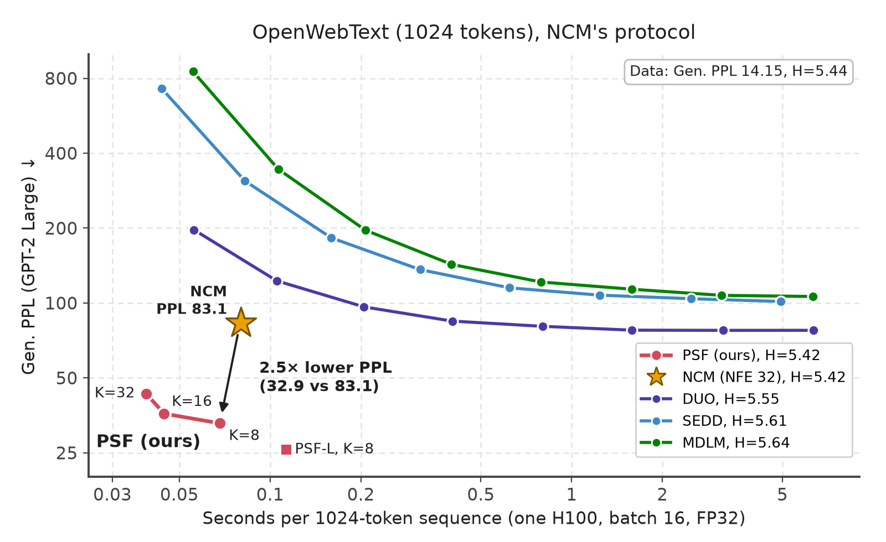
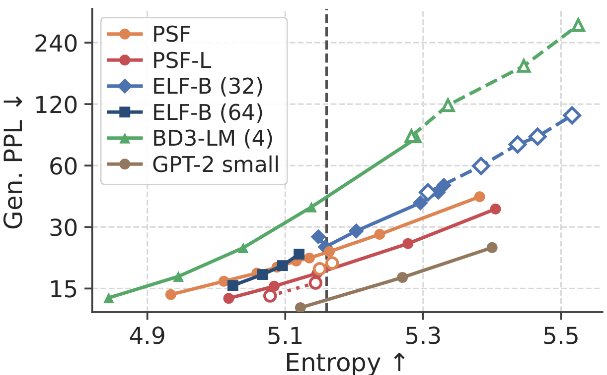

# Predictive-State Flows (PSF)

Code and checkpoints for **Rethinking the Roles of Diffusion and Decoding: Predictive-State Flows for Parallel
Language Generation**.

<p align="center">
Jinjin He<sup>*</sup>, Xinsong Feng<sup>*</sup>, Lucheng Fu, Sinan Wang, Bo Zhu, Jiayun Wang<br>
Georgia Institute of Technology<br>
<sup>*</sup>Equal contribution
</p>

<p align="center">
  <a href="https://arxiv.org/abs/2610.12898"></a>
  <a href="https://jinjinhe2001.github.io/psf/"></a>
  <a href="https://huggingface.co/jinjinhe2001/PSF-ParallelLM"></a>
  <a href="LICENSE"></a>
</p>

<p align="center">
  
  <br><sub>A version with playback controls is on the <a href="https://jinjinhe2001.github.io/psf/">project page</a> (video file: <a href="assets/generation.mp4">assets/generation.mp4</a>).</sub>
</p>

<p align="center">
  
</p>

The predictive state s<sub>k</sub> = E(x<sup>(&lt;k)</sup>) encodes the blocks before block k and does not see block k.
A flow prior generates all K states jointly from noise, and a block decoder then generates the K blocks in parallel.

## News

- **2026-10-22**: We evaluated PSF with the OpenWebText protocol of [NCM](https://github.com/HazyResearch/ncm), using
  NCM's scorer (GPT-2 Large, 5 seeds × 256 samples of 1024 tokens) and its timing setup (one H100, batch 16, FP32).
  At NCM's entropy (H = 5.42), PSF K=8 has a generative perplexity of 32.9, compared with 83.1 for NCM, and PSF-L
  has 25.8. The scripts, the differences from our paper's protocol and the full results are in
  [`scripts/ncm_protocol/`](scripts/ncm_protocol).

  <p align="center">
    
    <br><sub>MDLM, SEDD, DUO and NCM are taken from the NCM paper (Figure 5, Table 8). PSF is scored with NCM's scorer,
    interpolated to H = 5.42, and timed in FP32 with compiled graphs; this setup reproduces NCM's reported 80 ms per
    sequence.</sub>
  </p>

- **2026-10-12**: Code, all 11 checkpoints of the paper ([Hugging Face](https://huggingface.co/jinjinhe2001/PSF-ParallelLM)) and the [project page](https://jinjinhe2001.github.io/psf/) are public.
- **2026-10-09**: The paper is on [arXiv](https://arxiv.org/abs/2610.12898).

## Overview

In continuous diffusion language models, the latents generated by the diffusion prior are mapped almost
deterministically to tokens, so the prior has to model fine-grained token choices in a continuous space. In PSF,
the diffusion prior generates only *predictive information* about the upcoming text, and a decoder makes the
token-level choices.

```
document  ->  K blocks of L/K tokens
encoder   :  s_k = pooled state of blocks < k        (predictive state: no information from block k itself)
prior     :  noise --rectified flow, T steps-->  (s_1, ..., s_K)        joint, bidirectional over K states
decoder   :  block k <- s_<=k  (+ first token of block k+1)            all K blocks in parallel, AR inside a block
```

Diffusion then runs over `K << L` predictive states instead of `L` token-level states, and the token-level
sequential depth is `L/K`. On unconditional OpenWebText, a 197M-parameter model with `K = 8` has a generative
perplexity of 22.8 at entropy 5.16 and uses 0.31 TFLOPs per 1024-token document; ELF-B with 32 steps has 24.0 at
7.2 TFLOPs.

<p align="center">
  
  <br><sub>Figure 3a of the paper: generative perplexity against entropy on OpenWebText. PSF and PSF-L at K=8 with the
  plain sampler (solid) and the states-only nucleus sampler (hollow, dotted); ELF-B with 32/64 steps, BD3-LM with block
  4 (hollow dashed: their guidance/temperature sweeps). The dashed line marks entropy 5.16.</sub>
</p>

## Installation

```bash
git clone https://github.com/jinjinhe2001/Predictive-State-Flows-for-Parallel-Language-Generation.git
cd Predictive-State-Flows-for-Parallel-Language-Generation
pip install -r requirements.txt          # or: pip install -e ".[eval]"
python -m pytest -q tests                # ~1 min on CPU, no downloads
```

`requirements.txt` gives minimum versions; the exact environment of the paper's runs (Python 3.14, PyTorch 2.12,
8x H100 80GB, bfloat16 autocast) is listed at its top.

## Repository layout

```
psf/
  config.py              all dataclass configs
  models/                encoder_prefix (predictive states), decoder (block decoder), denoiser (flow prior), psf (full model), ar_lm
  diffusion/flow.py      rectified-flow loss and Euler sampler
  training/              losses and the two trainers
  utils/                 data loading, distributed helpers, generation metrics
scripts/                 entry points (training, sampling, evaluation, analyses)
  ncm_protocol/          evaluation and timing under NCM's OpenWebText protocol
configs/                 model flags, sampling settings, one training script per model, evaluation
tests/                   CPU tests: toy training pipeline, landing-target invariants
```

## Pretrained checkpoints

All checkpoints are in [jinjinhe2001/PSF-ParallelLM](https://huggingface.co/jinjinhe2001/PSF-ParallelLM). Each file
contains the encoder, block decoder and flow prior (EMA weights). The architecture is not stored in the file, so pass
the matching flags from [`configs/models/`](configs/models).

| Model | K | Generation params | File | Gen. PPL @ entropy | MAUVE@512 | TFLOPs / doc |
|---|---|---|---|---|---|---|
| PSF | 64 | 197M | `psf_k64.pt` | 41.15 @ 5.183 | 0.87 | 0.80 |
| PSF | 32 | 197M | `psf_k32.pt` | 33.56 @ 5.177 | 0.89 | 0.52 |
| PSF | 16 | 197M | `psf_k16.pt` | 25.67 @ 5.173 | 0.90 | 0.38 |
| PSF | 8 | 197M | `psf_k8.pt` | 22.75 @ 5.164 | 0.93 | 0.31 |
| PSF, states-only prior | 8 | 197M | `psf_k8_states-only.pt` | 18.95 @ 5.158 | 0.85 | 0.31 |
| PSF-L | 64 / 32 | 677M | `psf-l_k64.pt`, `psf-l_k32.pt` | 42.2 / 27.1 @ 5.16 (interpolated, block-length table) | | |
| PSF-L | 16 | 677M | `psf-l_k16.pt` | 21.22 @ 5.181 | 0.91 | 1.35 |
| PSF-L | 8 | 677M | `psf-l_k8.pt` | 17.79 @ 5.146 | 0.90 | 1.10 |
| PSF-L, states-only prior | 8 | 677M | `psf-l_k8_states-only.pt` | 15.98 @ 5.144 | 0.89 | 1.10 |
| Same-data AR baseline | - | 197M | `ar-197m.pt` | 15.37 @ 5.151 | 0.95 | 0.43 |

Numbers are from Table 1 of the paper (1000 samples, GPT-2 Large judge) with the sampling settings in
[`configs/sampling/`](configs/sampling).

```bash
hf download jinjinhe2001/PSF-ParallelLM --local-dir checkpoints                       # all files (21 GB)
hf download jinjinhe2001/PSF-ParallelLM --include "psf_k8*" --local-dir checkpoints    # only PSF K = 8
```

## Inference

Sample 1000 documents from PSF (K = 8) with the paper's plain sampler and score them:

```bash
python -m scripts.eval_gen --ckpt checkpoints/psf_k8.pt $(cat configs/models/psf_k8.args) \
    $(cat configs/sampling/psf_k8.args) --save-texts outputs/texts_psf_k8
```

`eval_gen` prints generative perplexity under GPT-2 Large, unigram entropy and repetition statistics for each
`temperature:top_p` pair in `--settings`, and writes the documents to JSONL. Main options:

| option | meaning |
|---|---|
| `--settings 0.75:0.95,0.8:0.95` | block-decoder temperature and nucleus threshold, one run per pair |
| `--sampling-steps 50` | Euler steps of the flow prior |
| `--rc-mode zero` | states-only generation (zero realization codes); use with the `*_states-only` checkpoints |
| `--no-repeat-ngram 4` | document-wide 4-gram ban |
| `--cfg-scale`, `--noise-scale` | prior guidance scale and initial-noise scale (both 1 in the paper's main rows) |
| `--recon` | true-plan decode: states from held-out documents instead of the prior |
| `--texts FILE.jsonl` | only score an existing dump (any model) |

`python -m scripts.sample_text` with the same model flags prints a few documents.

## Data preparation

All models train on ELF's pre-tokenized OpenWebText (T5 tokenizer, `google-t5/t5-small`):

```bash
python -m scripts.download_data --out data/openwebtext-t5    # embedded-language-flows/openwebtext-t5
```

Documents are cut or padded to a 1024-token canvas. A fixed random subset of 10,000 documents
(`numpy.random.default_rng(0)` permutation) is held out from training and used for evaluation
(`psf/utils/data.py`).

## Training

Each model has one script that runs the full training recipe of the paper in order (Section 3 and Appendix A). The
per-GPU batch sizes assume 8 GPUs.

```bash
bash configs/train/psf.sh            # PSF (d = 512) -> psf_k64, psf_k32, psf_k16, psf_k8, psf_k8_states-only
bash configs/train/psf.sh 7          # resume from step 7
bash configs/train/psf-l.sh          # PSF-L (d = 1024) -> psf-l_k64 ... psf-l_k8, psf-l_k8_states-only
bash configs/train/ar_baseline.sh    # same-data autoregressive baseline -> ar-197m
```

For PSF, step 1 trains the encoder and block decoder from scratch at K = 64, together with a base prior. Steps 2-5
fine-tune the block decoder on the frozen encoder (landing target, 18-layer decoder, self-realized prefixes,
realization codes), and step 6 trains the K = 64 prior. Steps 7-9 go down the block-length chain K = 32 -> 16 -> 8,
training a block decoder and a warm-started prior at each K, and step 10 trains the states-only prior. Each step is
commented in the script.

The underlying entry points are `scripts.train_ae` (encoder and block decoder, Stages I-II), `scripts.train_prior`
(flow prior, Stage III) and `scripts.train_ar`; `--help` lists every option. `--toy` runs either stage on a small
synthetic corpus on CPU.

## Evaluation

```bash
bash configs/eval/main_table.sh                                       # Table 1 quality columns
bash configs/eval/sweep.sh psf_k8 0.65:0.95,0.7:0.95,0.75:0.95,0.8:0.95   # sweep + interpolation to entropy 5.16
```

| Paper result | Script |
|---|---|
| generative perplexity, entropy, loop rate | `scripts/eval_gen.py`, `scripts/loop_full.py` |
| interpolation to entropy 5.16 | `scripts/isoentropy.py`, `scripts/window_summary.py` |
| MAUVE@512 | `scripts/mauve_eval.py --max-len 512`, references from `scripts/dump_real_texts.py` |
| FLOPs, latency, throughput | `scripts/bench_ours.py`, `scripts/flops_measure.py`, `scripts/latency_r4.py`, `scripts/latency_r5_steps.py` |
| likelihood bound | `scripts/elbo_probe.py` |
| other judges (Qwen2.5) | `scripts/eval_gen.py --texts FILE --judge Qwen/Qwen2.5-7B` |
| topic persistence, coherence | `scripts/topic_metrics.py`, `scripts/coherence_judge.py` |
| prompted continuation | `scripts/eval_prompted.py` |
| plan and code analyses | `scripts/plan_probe.py`, `scripts/meanplan_eval.py`, `scripts/codes_probe.py`, `scripts/code_viz.py` |
| baselines | `scripts/train_ar.py`, `scripts/sample_ar.py`, `scripts/sample_gpt2.py`, `scripts/elf_compare/` (ELF, BD3-LM, MDLM) |

## Checkpoint format

`torch.save({"model": state_dict, "steps": int})`, loadable with `torch.load(..., weights_only=True)`. A prior
checkpoint also holds the frozen encoder and block decoder and the latent normalization statistics, so one file is
enough for sampling.

## License

This project is released under the MIT license; see [LICENSE](LICENSE).

## Citation

```bibtex
@article{he2026psf,
  title   = {Rethinking the Roles of Diffusion and Decoding: Predictive-State Flows for Parallel Language Generation},
  author  = {He, Jinjin and Feng, Xinsong and Fu, Lucheng and Wang, Sinan and Zhu, Bo and Wang, Jiayun},
  journal = {arXiv preprint arXiv:2610.12898},
  year    = {2026}
}
```

## Acknowledgement

We train on the pre-tokenized OpenWebText release of [ELF](https://github.com/lillian039/ELF) and compare against
ELF, [BD3-LM](https://github.com/kuleshov-group/bd3lms) and MDLM using their released code and checkpoints. MAUVE
uses the [mauve-text](https://github.com/krishnap25/mauve) package.
